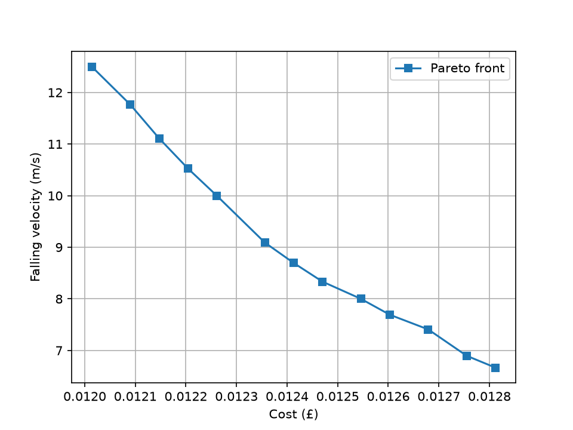

# Cost–Performance Multi-Objective Optimisation

This project explores the trade-off between **cost (£)** and **falling velocity (m/s)** using a Pareto-front representation. The plot compares candidate solutions so that lower-cost options can be evaluated against their falling-velocity performance.

## Pareto Front

*Figure 1. Pareto front for cost (£) versus falling velocity (m/s). Each marker represents a candidate solution.*

### How to interpret the plot

The Pareto front shows the set of **non-dominated solutions** for the two objectives:

- **Cost (x-axis):** lower values are preferable when minimising expenditure.
- **Falling velocity (y-axis):** lower values are preferable if the aim is to reduce falling velocity.
- **Trade-off:** moving from left to right increases cost while reducing falling velocity. A cheaper solution therefore comes with a higher falling velocity, while achieving a lower falling velocity requires accepting a higher cost.
- **Choosing a solution:** there is no single best point for every use case. The preferred point depends on the acceptable cost and the importance of reducing falling velocity.

A solution is *Pareto-dominated* if another solution is at least as good in both objectives and strictly better in at least one. Points on the Pareto front are non-dominated: improving one objective requires sacrificing some performance in the other, within the candidate solutions shown.

## Objectives

This visualisation presents a two-objective optimisation problem:

1. Minimise cost.
2. Minimise falling velocity.

The Pareto front helps make the trade-off visible and supports selecting a solution based on the project's budget and performance requirements.

## Repository figure

Keep `pareto_front.png` in the same directory as this `README.md` so that the image renders correctly on GitHub.

## Notes

The README describes the information visible in the supplied plot. Add the project's specific optimisation algorithm, dataset/source of candidate solutions, and instructions for reproducing the figure when those details are available.
