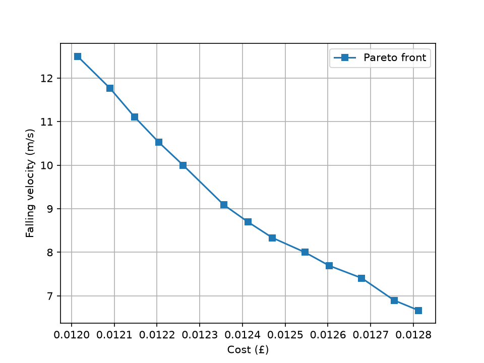

# Engineering Optimisation: Multi-Objective Paper Helicopter Design

## Project Overview

This project investigates the application of **engineering optimisation and computational modelling** to the design of a paper helicopter, analysing the trade-off between manufacturing cost (£) and falling velocity (m/s).

The project formulates a multi-objective optimisation problem to identify paper helicopter configurations that balance economic efficiency with aerodynamic performance.

Using numerical optimisation, mathematical analysis and physical experimentation, the project evaluates candidate designs and investigates whether theoretically optimal configurations translate into improved real-world performance.

The work combines applied mathematics, computational engineering, experimental validation and collaborative problem-solving.

## Technology Stack

| Technology / Method | Application |
|---|---|
| Python | Computational modelling and optimisation workflows |
| NumPy | Numerical computation and mathematical operations |
| pymoo | Multi-objective optimisation and Pareto-front generation |
| KKT Conditions | Mathematical analysis of constrained optimisation and optimality |
| Engineering Optimisation | Evaluating competing design objectives and constraints |
| Physical Experimentation | Validating theoretical predictions against measured performance |

## Optimisation Objectives

The project investigates two competing engineering objectives:

1. **Minimise manufacturing cost (£).**
2. **Minimise falling velocity (m/s).**

The optimisation process evaluates candidate designs to identify configurations that provide the best balance between cost and aerodynamic performance.

### Pareto Front

*Figure 1. Pareto front illustrating the relationship between manufacturing cost (£) and falling velocity (m/s) across candidate paper helicopter designs.*

### Interpretation

The Pareto front represents the set of non-dominated solutions across the two objectives.

- **Cost (x-axis):** Lower values are preferable when minimising manufacturing expenditure.
- **Falling velocity (y-axis):** Lower values are preferable for achieving a slower descent.
- **Trade-off:** Reducing falling velocity can require additional material or manufacturing expenditure.
- **Design selection:** The preferred configuration depends on the acceptable budget and required aerodynamic performance.

A solution is Pareto-dominated if another solution performs at least as well in both objectives and strictly better in one. Solutions on the Pareto front are non-dominated, meaning improving one objective requires sacrificing performance in the other.

## Mathematical Optimisation and KKT Conditions

The project incorporates constrained engineering optimisation principles, including the **Karush–Kuhn–Tucker (KKT) conditions**.

The KKT framework provides the mathematical foundations for analysing constrained optimisation problems through four conditions:

- Stationarity of the objective function.
- Primal feasibility of the constraints.
- Dual feasibility of the Lagrange multipliers.
- Complementary slackness.

These conditions provide a framework for understanding optimality when engineering design variables are subject to practical constraints.

The computational optimisation workflow uses Python, NumPy and pymoo to evaluate candidate solutions and investigate the relationship between competing design objectives.

## Analytical and Experimental Testing

Following the computational optimisation stage, physical testing was conducted to evaluate the performance of the selected paper helicopter configurations.

The experimental results were compared against theoretical falling velocity calculations to assess the accuracy of the optimisation process.

### 1. Experimental Results

Two principal design configurations were evaluated:

| Performance metric | Low-cost design | Low-velocity design |
|---|---:|---:|
| Experimental falling velocity | 1.02 m/s | 0.91 m/s |
| Theoretical falling velocity | 1.17 m/s | 1.11 m/s |
| Theoretical vs experimental difference | 12.82% | 18.01% |

The low-velocity configuration achieved an experimental falling velocity of **0.91 m/s**, compared with **1.02 m/s** for the low-cost configuration.

This represents an approximately **10.78% reduction in falling velocity**, demonstrating improved descent performance for the low-velocity design.

However, the theoretical calculations showed discrepancies against the experimental measurements, particularly for the low-velocity configuration.

### 2. Repeated Drop-Test Measurements

Multiple experimental attempts were recorded for the four design configurations.

| Configuration | Attempt 1 | Attempt 2 | Attempt 3 | Average |
|---|---:|---:|---:|---:|
| Low-cost V1 | 2.198 s | 2.770 s | 2.534 s | 2.501 s |
| Low-cost V2 | 2.372 s | 2.345 s | 2.286 s | 2.334 s |
| Low-velocity V1 | N/A | 2.790 s | 3.000 s | 2.895 s |
| Low-velocity V2 | 2.300 s | 2.576 s | 2.571 s | 2.482 s |

*Note: Low-velocity V1 contains two valid recorded attempts because the first measurement was unavailable. Averages are calculated from available measurements.*

The repeated drop tests demonstrate variation between individual attempts, highlighting the importance of experimental consistency when evaluating engineering designs.

### 3. Experimental Limitations and Sources of Error

The physical testing identified several factors that could influence the accuracy and repeatability of the results:

- **Inconsistent drop heights:** The release height was not perfectly controlled between iterations.
- **Manufacturing tolerances:** Small differences in fabrication affected the consistency of individual helicopter designs.
- **Mass inconsistencies:** Models were not individually weighed, and paper density and mass variations were not fully accounted for.
- **Paper clip positioning:** The location of the paper clips was not consistently controlled.
- **External forces:** Air resistance, breezes and unintended forces during release influenced the descent.
- **Measurement accuracy:** Video-based timing at 120 FPS still
